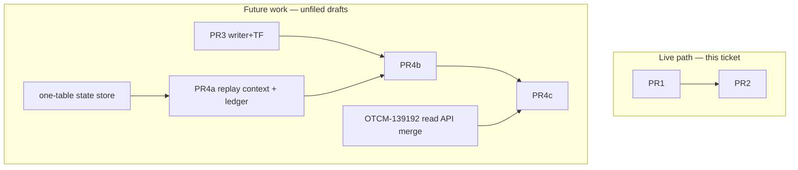

# OTCM-138123 — WMS-I-1005 idempotency + replay context

## Overview

Implement the spike's two idempotency changes (hardened by a two-round adversarial panel). Everything replay- and table-shaped is OUT: the replay MECHANISM (writer lifecycle, reprocess use case, `POST /transaction-failures/{failure_id}/reprocess`) by owner decision 2026-11-11 (Jira comment 983147), and the replay context + publish ledger + one-table state store by lead decision the same day (Gabriel: the whole table issue is out of scope). The deferred designs live as unfiled drafts in `notes/future-work/` (`followup_transaction_failures_replay_lifecycle.md`, `one_table_state_store_baseline.md`).

Design was verified by 3 independent seats (round 1) and 2 adversarial seats (round 2, both ADOPT WITH CHANGES); all foldable claims were re-verified against the code by hand.

**Ticket**: [OTCM-138123](https://warbyparker.atlassian.net/browse/OTCM-138123) — "Evaluate how to make WMS-I-1005 idempotent to safely support reprocess from `transaction_failures` without duplicating downstream effects (Oracle/LMS side effects on retry)."

**Working ACs** (ratified with owner; re-scoped 2026-11-11):
- AC1 — Retry of an already-succeeded attempt produces ZERO new side effects (no double pick confirm, no duplicate fulfillment event, no duplicate LMS/DST file, no retry-caused short-pick cancellation).
- AC2 — MOVED to the follow-up ticket (every WMS-I-1005 `transaction_failures` row has a defined replay outcome) — it is a property of the reprocess use case.
- AC3 — MOVED to the follow-up ticket (operator-triggered replay, FAILED → RETRYING → RESOLVED/FAILED/DEAD, concurrency safety).
- AC4 — No regression on the live first-attempt path (100% unit-coverage gate).

## Verified facts the plan builds on

- Orchestrator [`_wms_pick_confirmation.py`](monocle_integrations/_domain/_integrations/_wp_wms_i_1005_wms_to_oracle_pick_confirmation/_wms_pick_confirmation.py): map/validate → **DST step (LMS side effect) runs BEFORE Oracle** → roosevelt/legacy processing → archive payload to S3 `Archive/` or `Error/` → `_record_failures` stamps payload pointer (bucket/key/version_id) and writes buffered rows. `tracking_id = uuid4()` per run.
- [`_erp_pick_confirm_processor.py`](monocle_integrations/_domain/_integrations/_wp_wms_i_1005_wms_to_oracle_pick_confirmation/_processors/_erp_pick_confirm_processor.py): `_validate_and_filter_eligible_shipment_lines` (~L996) raises `PickConfirmNotAllowedError` when ALL lines **of the whole order** are in `_NOT_ELIGIBLE_STATUSES = {Canceled, Interfaced, Staged}`; quantity map fed `eligible_lines_to_confirm + eligible_lines_to_release` only (L226-229); multi-slip branch posts full `slip.requested` per line ignoring picked total (~L712-719); single-slip branch posts item picked total onto possibly smaller slip (~L720-723); **second call site** at L290 (roosevelt post-wave re-read, tuple-unpacks the result).
- SO publish exclusion ([`_wms_pick_confirmation.py:529`](monocle_integrations/_domain/_integrations/_wp_wms_i_1005_wms_to_oracle_pick_confirmation/_wms_pick_confirmation.py)) `_exclude_failed_erp_sales_orders` excludes only orders whose ERP result **raised** — a skip-success return would publish (duplicate fulfillment event; SNS FIFO dedupe window is 5 min only).
- `transaction_id = sha256(org-ship_set-fr_ids-event_timestamp)`, `event_timestamp` from WMS payload `picked` field → **stable across replays**.
- Writer [`_transaction_failure_dynamodb_action.py`](monocle_integrations/_adapters/_transaction_failure_actions/_transaction_failure_dynamodb_action.py): unconditional upsert, `#status = if_not_exists(#status, :failed)` (recurrence after RESOLVED stays invisible), payload pointer fields overwritten on every re-record, `retry_count` never written. No `ConditionExpression` anywhere.
- Table GSIs (localstack TF): `status`+`last_failed_at`, `rice_id`+`last_failed_at`, `order_id`+`last_failed_at`. No payload-pointer GSI. Port record [`_transaction_failure_record.py`](monocle_integrations/_domain/_ports/_transaction_failure/_transaction_failure_record.py) has all 5 statuses + `retry_count`; `idempotency_key`/`last_retry_at`/`reprocessed_*`/`ttl` do NOT exist.
- Read API (OTCM-139192, in QA as vstage449): adapters + domain ports on `main`; **routes only on branch `origin/OTCM-139192-transaction-failure-routes`** ([`_api/_routes/_transaction_failure/`](monocle_integrations/_api/_routes/)), diverged from main. AVP actions exist on main: `viewTransactionFailures` / `manageTransactionFailures` ([`_api/_authorization/_actions.py`](monocle_integrations/_api/_authorization/_actions.py)); `transaction_failures.manage` defined, unused.
- `fulfill-events-sns-topic` + `fulfill-events-source-type` = `true` in prod/stage/dev ([`_feature_flag_config/prod.yml`](monocle_integrations/_feature_flag_config/prod.yml)) — SO events publish to SNS FIFO `labs-fulfill-events-prod-use1.fifo`.
- `FileContentReader.__call__(file_path)` ([`_file_storage/_reader.py`](monocle_integrations/_domain/_ports/_file_storage/_reader.py)) — no version_id support today.
- Facade attribute: `wp_in_wms_i_1005_wms_to_oracle_pick_confirmation(request: List[WMSPickOrder])`, called by [`_scale_wms_pick_confirmation_routes.py:100`](monocle_integrations/_api/_routes/_pick_ship_confirm/_scale_wms_pick_confirmation_routes.py) under `set_rice_id(...)`.
- `PickFailedStep` ([`_constants.py`](monocle_integrations/_domain/_integrations/_wp_wms_i_1005_wms_to_oracle_pick_confirmation/_constants.py)): `resolve_erp_order_number`, `read_shipment_lines`, `create_pick_wave`, `read_pick_slip`, `create_pick_confirm`, `publish_fulfillment_pick_event`, `wms_pick_confirmation`, `archive_payload`.

## PR split

Stack: PR1 [#2900](https://github.com/WarbyParker/monocle_integrations/pull/2900) ← PR2 [#2904](https://github.com/WarbyParker/monocle_integrations/pull/2904) (linked as stack #2905). Each PR passes the full gate alone (100% unit coverage, mypy strict, line 99).

- **PR1 — `[OTCM-138123] Skip pick confirmation when request-matched lines are pick-terminal`** (~380 lines incl. tests)
  - New `PICK_TERMINAL_SHIPMENT_LINE_STATUSES` frozenset = {Staged, Shipped, Interfaced, Shipped and interfaced, Pending inventory processing} in [`_shipment_lines_reader.py`](monocle_integrations/_domain/_ports/_erp_reader/_pick_ship_confirm/_shipment_lines_reader.py) (ship-side sets untouched).
  - Rewrite `_validate_and_filter_eligible_shipment_lines` → request-matched classifier (SO by FR id `src_attribute_2`; TO by item): partition matched lines first; all matched pick-terminal → skip-success instead of raise, EXCEPT the FSD §10 rows which still fail: any unmatched request key (`PickConfirmNoMatchingShipmentLinesError`), all matched canceled, any matched ship-confirmed (`PickConfirmNotAllowedError`). **Both call sites** (L208 main, L290 roosevelt re-read) get skip semantics.
  - New dedicated zero-match error code (data mismatch stops masquerading as `OverpickedQuantityError`); partial match classified loudly.
  - Classify or prove-unreachable the unclassified statuses (`Not shipped`, `Not applicable`).
  - Skip-success carries the `skip_reason` log (the only signal left for pick-terminal duplicates — Staged/Interfaced/`Pending inventory processing` — which have no FSD error row). Review resolution: keep the plain interpolated text QA greps for AC4-d, no structured field.
  - Skip representation: `ERPPickedDetail` with no lines + additive skip marker; does NOT leak into SO event payloads (events build from `PickOrder`).
  - Depends on: nothing.
  - **SHIPPED 2026-11-10 as [#2900](https://github.com/WarbyParker/monocle_integrations/pull/2900)** (+1020/−139, 14 files). Two panel rounds resolved (round 1: 16 findings; round 2 on the delta: 12 findings, all implemented — records in `tmp/otcm138123_pr1_review/triage_plan.yaml` and `tmp/otcm138123_pr1_review_r2/triage_plan.yaml`). Scope grew in review: identity-based publish exclusion + `omg_skipped` attachment + key-collision WARNING naming work units; `PickConfirmNoEligibleShipmentLinesError` for matched lines with no pick work, message keyed by (line id, item, status, FR); success-path WARNING for ignored unworkable lines; `recorded_failure` assertions on the new error tests. **MERGE GATE: (a) stage evidence that `Pending inventory processing` is pick-terminal, (b) stage evidence that Oracle safely rejects a double-confirm POST. (c) ANSWERED 2026-11-10 (Gabriel, Slack): partial coverage is not a real scenario, but he wants at least a warning → per user directive the no-match and no-eligible raises are replaced by WARNING + skip/proceed (TO confirms only the covered lines, request lines scoped by `unmatched_request_keys` so the uncovered line cannot trip OVER_PICK; SO skips the whole order because request lines carry no FR attribution), both exception classes dropped, "unworkable" renamed "ignored". Rework in flight in `tmp/pr1-warning-wt`, lands on #2900 before merge.**
  - **2026-11-12 UPDATE (Bugbot round 3, commits `7deb7e265` + `80374d0c8` on #2900):** the skip is now typed (`SkipReason` StrEnum on `ERPPickedDetail.skip_reason`). `PICK_TERMINAL` (Staged/Interfaced/`Pending inventory processing`; also any pick-terminal matched line when no line is eligible — CANCELED does NOT count as pick evidence for this reclassification, though it still counts in the all-pick-done check) withholds the OMG event as a duplicate. `NO_ELIGIBLE_WORK` (known-ineligible `Not shipped`/`Not applicable`) skips the ERP leg but PUBLISHES the OMG event. Unrecognized statuses raise `PickConfirmUnknownShipmentLineStatusError` (ticket), hoisted above the eligibility gate so they fail even beside eligible lines. `no_pick_work*` renamed `no_eligible_work*`; ignored-lines log demoted WARNING→INFO; `_collect_erp_skips` exhaustive over the enum. Light panel + 2 triage seats, 20 clusters, gray findings resolved by owner — records in `tmp/pr2900_review/triage_plan.yaml`. Accepted residuals live in the PR description; durable drafts (unfiled/unposted, awaiting the user) at `tickets/OTCM-138123/followup_omg_dedupe_republished_fulfillment_events.md` and `tickets/OTCM-138123/comment_983303_second_read_residual.md`.
  - **2026-11-12 PM UPDATE (rounds 4–5, commits `2e16822b2` + `7b7c10cf5` on #2900):** the status-name split is gone — all four post-ship statuses share the quantity gate: a matched post-ship line with `picked_quantity > 0` is pick-done (skip), with none it refuses ship-confirmed-and-not-yet-picked; Staged stays an unconditional skip. Driver: Guillermo's IN-I-2017B lifecycle evidence (Oracle moves lines Shipped → `Pending inventory processing` → Interfaced 7–28s after ship confirm, so the split ticketed a redelivery at second 0 and skipped the identical one at second 30). Post-ship classification lives in `_shipment_line_classifier.py` (`classify_shipment_lines` → `ShipmentLinePickVerdict`). The reader coerces null/missing `PickedQuantity` to 0 (guard survived the round-5 revert vote). Companion evidence: zero negative `PickedQuantity` in a prod S3 sweep of 24k+ payloads (HTTP-path backups stop 2025-12-31; traffic since flows via SQS/roosevelt). All 13 PR threads answered (records in `tmp/pr_comment_replies.yaml`). **APPROVED 2026-11-13 (Guillermo, Johnny Coral).**

- **PR2 — `[OTCM-138123] Count done work in pick quantities and cap slip posting by picked budget`**. **SHIPPED 2026-11-10 as [#2904](https://github.com/WarbyParker/monocle_integrations/pull/2904)** (+1902/−157, 7 files, stacked on #2900; stack linked as stack #2905). Three light panel rounds resolved (round 1: 21 findings; round 2: 7 findings; round 3: 4 seats — replica re-decision + 5 adopted items). Full-repo coverage gate green (8,868 passed, 100%).
  - **2026-11-12 REBASE onto PR1 tip `80374d0c8`** (force-pushed: old tip `83c2d1963` → new tips `77545b8a6` + `aeeb512a9`; #2904 MERGEABLE again). Conflicts in `_erp_pick_confirm_processor.py` resolved as a union: `_EligibleShipmentLines` carries PR2's `counted`/`done` AND PR1's typed `SkipReason`; all four construction sites (all-pick-done, any-pick-terminal, no-eligible, eligible) pass both; the exception list keeps `PickConfirmUnknownShipmentLineStatusError` + `PickConfirmAllocationError`. PR2's `done_lines` already used `PICK_TERMINAL_SHIPMENT_LINE_STATUSES` (canceled excluded) — consistent with the `80374d0c8` fix. Gates on the rebased branch: 331 scoped + 6 API + 9,589 coverage (100%).
  - **2026-11-13 REBASE onto PR1 tip `7b7c10cf5`** (force-pushed: old tips `77545b8a6`/`aeeb512a9` → new tips `1aae10dcd` + `f0e863ee0`). Two conflict rounds: (1) processor + tests — the `counted`/`done` partition moved INTO the classifier (`ShipmentLineClassification.counted_lines`/`done_lines`, `done` = pick-terminal under the quantity gate) instead of PR2's original processor-side comprehensions, so the budget math inherits the unified semantics; the processor's verdict mapper passes them through; (2) test helpers — union of both helper sets, duplicate `_assert_no_writes` dropped for HEAD's `_assert_no_erp_writes` (3 call sites renamed). The parallel tab's uncommitted WIP (`stale_lines_possible` → `unfiltered_slip_read` rename + comment trims) was stashed for the rebase and popped back clean — still uncommitted, that tab's call to commit. Gates on the rebased branch: 363 scoped + 13 API + 9,623 coverage (100%) + mypy strict. Classifier-extension veto belongs to the parallel tab.
  - `_map_order_line_quantities` fed all non-canceled **request-matched** lines (not eligible-only).
  - Picked-budget allocation in confirm mapping: `budget = picked − Σ requested of terminal matched lines`; per slip line in deterministic order post `min(slip.requested, remaining_budget)`; serials sliced to posted quantity; None-guard on `requested_quantity` (Optional[int]).
  - Capping driven by anything other than slip-requested raises (records a row) — no silent under/over-confirm.
  - Per-line Short Pick reason only on actual quantity mismatch (FSD §4 + Alexis Tomacruz's 2026-05-28 FSD comment); fixes the PICK_EXACT → SHORT_PICK_RESERVE flip for multi-wave remainders.
  - Empty-confirm guard: skip-success when zero **mapped** pick lines (never keyed on picked>0 — zero-pick short picks legitimately post `picked_quantity: 0`); "wave created this run → never skip" clause.
  - True overpick still refuses pre-write (`_check_over_picked_lines`, L247).
  - Depends on: PR1 (same processor file).
  - Review resolutions (2026-11-10, light panel round 1 — 21 findings; records in `tmp/otcm138123_pr2_review/triage_plan.yaml`):
    - Quantity math scoped to payload items (`_2`): a matched shipment line whose item the payload does not carry (AI/SURF lens+frame pairs sharing `SrcAttribute2`) no longer enters the ordered/done sums — fixes the false "done exceeds picked" refusal on the second sequential payload.
    - Serial done-offset (`_4`): replayed serial lists resume at `done_qty` (assumes attempt 1 consumed serials in the same fill order).
    - Two-way empty-confirm guard (`_5a`): skip-success iff no wave created this run AND every request item has no new picked work; raise otherwise. **REVERTED 2026-11-10 (owner veto): old logic restored — an empty mapped set always raises `PickConfirmationError` (OEH ticket), never skip-success.**
    - No-new-work hardening (`_1A`): slip lines of an item whose picked quantity is already fully confirmed (picked == done, budget not inventory-capped) are skipped — an incremental-shaped replay no longer posts 0 + Short Pick that would cancel the open remainder (AC4-e).
    - Containment refusal (`_3A`, amended round 2): unfiltered slip reads (TO + legacy SO) with a partially confirmed item that still has postable budget raise `PickConfirmAllocationError` before the pick wave (was after it — no orphaned wave) instead of guessing open slip lines; an item with picked == done passes the check (no false refusal), and the empty mapped set then raises per the restored `_5a` old logic. Stale-line replay safety rides the roosevelt SO join until TO line-level matching lands (follow-up ticket).
    - Absorb-on-None (`_7A`): a slip line with null `RequestedQuantity` absorbs the item's open budget (was: posts 0). ~~REVERTED (owner veto): null posts 0~~ **RE-DECIDED 2026-11-10 (round 3): exact replica of live behavior — a single-line item with null quantity absorbs the done-aware remaining budget; a multi-line item with a null quantity raises a typed `PickConfirmAllocationError` (live crashes `int(None)` TypeError — same loud outcome, catchable class). The 0-post/exemption round-2 state is gone (panel proved "posts 0" was never the live behavior for picked > 0).**
    - Refusal union (`_10A`): the unallocated-budget refusal seeds from every request item's budget, so picked quantity with no open slip line fails loud instead of mapping empty.
    - New `PickFailedStep.ADJUST_QUANTITIES` (`_18A`): done-exceeds-picked and overpick failures stamp `adjust_quantities` (was `validate_shipment_lines`).
    - Garbage clamps (`_19A`): negative inventory caps allocation at 0; negative slip requested posts 0 → unallocated refusal.
    - Accepted/deferred: done basis in requested units (AC4-f stage gate, `_6`); INV-status reason carve-out awaits functional + FSD addendum (`_9`); stale-done race (`_11`) deferred; FedEx IN-I-2017B semantics drift (`_20`) → follow-up ticket draft.
  - Routed functional/stage questions (ride the QA task): ① WMS `PickedQuantity` cumulative vs per-message; ② AI/SURF lens+frame lines share `SrcAttribute2`; ③ does Oracle `pickLines` return confirmed slip lines (extends PR1's gate); ④ null `RequestedQuantity` on live payloads; ⑤ Oracle's pre-ESS representation of a short-picked line (AC4-f).
  - Review resolutions (2026-11-10, light panel round 2 — 7 findings; reports in `/tmp/otcm138123_pr2_review/panels/round2/`):
    - `_3A` narrowed + moved pre-wave (code_2/req_2 CONCERNs): predicate gained `picked_qty > 0` and the refusal fires before wave creation (stamps `adjust_quantities`), closing the orphaned-wave perma-fail loop and the false refusal of clean incremental TO replays.
    - `_5a` wave-created cell test (req_1): wave releases work whose budget is already confirmed → raise names the wave in the message.
    - `_2` sibling test hardened (req_1): explicit frame+lens slip lines prove the non-payload slip line is skipped with no 0-post and no Short Pick reason.
    - Error message distinguishes causes (req_2): the no-mapped-lines raise appends "A pick wave was created this run." when applicable.
    - Serial done-offset × multi-slip test (req_2): the offset applies once per item across slip lines.
    - `_11` note (code_2): absorb-on-None defeats the unallocated-raise bound for a null-quantity slip line; acceptable — the bound stays a safety net for fully-specified slips, and `_11` remains deferred. **Final state (round 3): the replica's single-line absorb does consume the budget, so a null-quantity line cannot leave unallocated picked — the bound keeps full force for fully-specified slips.**
    - Not adopted: zero-pick + null-quantity 0-post without a reason (pre-existing, rides question ④); OEH message-prefix triage and the split-pick TO perma-fail class (fold into the PR description call-outs, `_21`).
  - Owner directives (2026-11-10, after the old-logic-change report): `_5a` empty-guard skip-success **reverted to old behavior** — an empty mapped set always raises `PickConfirmationError`, never skip-success; a fully confirmed replay now ends in the same `PickConfirmationError` as live (PR4b's replay path must classify that error as already-done when the row's step is `create_pick_confirm`). `_7A` **re-decided in round 3** to exact replica of live (see the `_7A` bullet) with two accepted caveats: multi-line null raises typed `PickConfirmAllocationError` instead of TypeError, and single-line null absorbs the done-aware remaining budget (not raw picked — raw picked would re-open the double-confirm bug; raw picked is surfaced on a per-item log line instead, owner directive "caveat 2: include the raw picked somewhere").
  - Review resolutions (2026-11-10, light panel round 3 — 4 seats: 2 APPROVE WITH NITS / CHANGES REQUESTED, 2 CHANGES REQUESTED; reports in `/tmp/otcm138123_pr2_review/panels/round3/`):
    - `_7A` replica implemented per the re-decision: `lines_per_item` counting in `_allocate_pick_lines`; `null_quantity_items` + the `_10A` exemption deleted; absorb test restored (single-line posts the budget with serials); new multi-line-null raise test; the multi-line refusal message carries the budget context "(already confirmed: X, open budget: Y)".
    - Already-confirmed clause (round-3 adopted 3): the no-mapped-lines raise appends "The picked quantity for items [...] is already confirmed." when `done_qty > 0`, so the OEH ticket distinguishes fully-done replays from data mismatches; tests pin presence (no-new-work + wave-cell tests) and absence (foreign-slip wave test).
    - Raw-picked logging (round-3 caveat 2): `_determine_pick_type_and_adjust_quantities` logs per item "raw picked %s, done %s, allocated %s, inventory %s" — replay forensics show what WMS claimed before done-work accounting.
    - `line_serials or None` (round-3 adopted 4): an empty adjusted serial list serializes as `null` like the non-serial path, not `[]`.
    - ZERO/RESERVE status fix (round-3 adopted 5): `picked_qty == 0 and inventory_qty != 0` → ZERO restores the old RESERVE mapping at picked 0 & inventory 0 (new edge test pins RESERVE + Short Pick reason at 0/0).
    - Clamp pins (round-3 adopted 6): negative-inventory test asserts the adjusted `picked_qty == 0` and INV status in the response quantities.
    - Stale "absorbs" docstring sentence (round-3 adopted 2): `_allocate_pick_lines` docstring rewritten for the replica semantics.
    - Not adopted (deferred to `_21` PR-description call-outs): wave-note on the unallocated refusal message; overpick-step OEH call-out; req_1's exemption-scope tests are moot (exemption deleted).

- **PR3 — `[OTCM-138123] Extend transaction_failures writer for the replay lifecycle`** — **MOVED OUT 2026-11-11 (owner decision: out of this ticket's scope, belongs to its own ticket).** Implemented and tested on branch `OTCM-138123-transaction-failure-replay-lifecycle` (working tree stashed there = reference implementation for the follow-up ticket): reopen semantics with evidence-only fallback, `TransactionFailureStatusUpdateAction` port + DynamoDB adapter (claim with 1h lease, outcome write-back, ttl), record/mapper fields, LocalStack TTL block. Finding folded into the follow-up draft: TTL is ALREADY enabled on every deployed table (`infra-terraform/service-monocle-integration/dynamodb/main.tf`, `ttl_enabled = true` on attribute `ttl`; streams on, NEW_AND_OLD_IMAGES) — no SRE ask needed.

- **PR4a — MOVED OUT 2026-11-11 (lead decision, Gabriel: the whole table issue is out of scope).** Without the publish ledger (which needed a new table) the remaining pieces — `PickReplayContext`, DST suppression, SO publish gate — are inert scaffolding whose only consumer is the follow-up's reprocess use case, so the whole PR4a folds into the replay follow-up draft in `notes/future-work/`. Original scope for the record: replay context (`suppress_dst`, `order_failed_steps`); orchestrator `__call__(request, replay=None)` byte-identical without it; publish gate keyed on `failed_step`; DynamoDB publish ledger keyed by `transaction_id` (batch-get before send, conditional-put after) closing the "run-1 confirm ok + publish fails → reprocess loses the event" hole that PR1's skip-exclusion leaves open. The ledger's design grew into the one-table state store (`notes/future-work/one_table_state_store_baseline.md`, panel- and adversarial-review-validated), itself parked. Residual risk accepted meanwhile: a re-driven order whose first attempt failed at publish never gets its fulfillment event (PR1's skip-exclusion suppresses it) — manual repair until the follow-up lands. PR4a branch `OTCM-138123-pick-replay-context` carried no commits of its own.

- **PR4b — MOVED OUT 2026-11-11 → follow-up ticket** (same draft; the use case builds on PR3's status-update action and consumes PR4a's replay context). Original scope for the record:
  - New use case package `_domain/_use_cases/_reprocess_transaction_failure/` (or integration-adjacent `_steps` if it fits facade conventions better — decide at implementation).
  - Flow: by-id read → refusals (row signals only: status ∉ {FAILED}; null payload pointer → "correct and re-POST from OIC"; `retry_count` at cap → DEAD (None coerced to 0); unsupported rice_id) → sibling resolution (load payload → order ids → `order_id` GSI per order → filter rice_id=WMS-I-1005) → **atomic payload claim**: one `TransactWriteItems` ConditionCheck+Update over ALL sibling rows FAILED → RETRYING (any non-FAILED row aborts → 409 already-replaying; >90 siblings refused with documented reason — DynamoDB 100-item transaction cap) → payload load via `FileContentReader` extended with optional `version_id` (fallback unversioned GET) → parse `List[WMSPickOrder]` → facade call with `PickReplayContext` (`suppress_dst=True` when all claimed rows are per-order; per-order `failed_step` map) → per-order outcome stamping (RESOLVED + `reprocessed_at` + `ttl`; failures back to FAILED — the run's own recording bumps `occurrence_count` on the same `failure_id`; DEAD past cap; never stamp rows in DEAD/IGNORED or a RETRYING held by another operator).
  - Stuck-RETRYING lease: `last_retry_at` older than the lease timeout (1h) is claimable again.
  - RETRYING-lease + claim/write-back go through PR3's `TransactionFailureStatusUpdateAction`.
  - Depends on: PR4a, PR3.

- **PR4c — MOVED OUT 2026-11-11 → follow-up ticket** (same draft; still gated on the OTCM-139192 read-API stack merging). Original scope for the record:
  - Route beside the read routes in [`_transaction_failure_routes.py`](monocle_integrations/_api/_routes/_transaction_failure/_transaction_failure_routes.py): thin handler, CF-JWT identity → `reprocessed_by`, AVP check.
  - [`_actions.py`](monocle_integrations/_api/_authorization/_actions.py): add `"/transaction-failures/{failure_id}/reprocess": MANAGE_TRANSACTION_FAILURES` to `ROUTE_ACTIONS`.
  - Read-API response models extended additively with the PR3 fields.
  - Depends on: PR4b AND **read-API stack (OTCM-139192) merged to main** — external dependency, in QA now. If it hasn't merged when PR4b lands, PR4c stacks on `OTCM-139192-transaction-failure-routes`.

- **Follow-up ticket draft (file only, never filed)**: `tickets/OTCM-138123/followup_to_line_level_matching.md` — TO line-level matching via movement request / `source_order_line`, covering BOTH the confirm path and the skip path (same-item TO siblings can mis-skip or mis-confirm; FSD confirms data feasibility via `OrderLineNumber` ↔ `ERPOrderLine`).

## QA test-scenarios matrix (requirement-traceable)

We run against stage; QA verifies. Evidence per `jira-qa-evidence` skill (OIC instance ids, Lambda logs, DynamoDB row snapshots, Oracle shipment-line states before/after).

- **AC1-a** Re-delivery of a fully-succeeded payload (re-POST from OIC / duplicate Kinesis event) → zero new side effects: Oracle shipment lines unchanged, no new fulfillment event on `labs-fulfill-events`, no new `.dst` on the LMS share. (unit + stage)
- **AC1-b / AC1-c — MOVED to the replay follow-up** (they need the publish gate + replay context): re-delivery of a publish-failed order republishes exactly once; re-delivery of a confirm-failed order suppresses DST and publishes exactly once. Meanwhile residual: on live re-delivery of a publish-failed order, PR1's skip-exclusion suppresses the duplicate event entirely — zero side effects, but the event stays missing until manual repair.
- **AC1-d** False-overpick class (9 OEH ticket classes): pre-D1 row re-delivers to success post-D1. (unit per class + 1 stage case)
- **AC1-e** Partial re-delivery (some request lines already terminal) → only remaining work confirmed; no short-pick cancellation of siblings. (unit + stage)
- **AC2 / AC3 rows — MOVED to the follow-up ticket** (reprocess use case + route + lifecycle): true-overpick harmless re-refusal, archive/mapping refusal reasons, retry cap → DEAD, concurrent-replay mutex, RETRYING lease, reopen semantics. Kept here for the record when the follow-up gets groomed.
- **AC4-a** Exact first picks byte-identical (existing unit suite + 1 stage order per order type: SO, TO, lens/frame incremental AI/SURF). (unit + stage)
- **AC4-b** Short-pick multi-slip first attempt → capped posting, per-line Short Pick reason only where mismatched; ESS auto-cancel behaves per FSD §4. (unit + stage, QA sign-off — behavior change)
- **AC4-c** Zero-pick short pick → still posts `picked_quantity: 0` + Short Pick (NOT skipped). (unit + stage)
- **AC4-d** Pick-terminal duplicate pick conf (Staged / Interfaced / `Pending inventory processing`) → skip-success, no Jira ticket, `skip_reason` in logs. (unit + stage, QA sign-off — behavior change vs the old `PickConfirmNoEligibleShipmentLinesError` ticket; no FSD error row covers these statuses). Canceled-TO and ship-confirmed pick confs are NOT in this row: they fail with a ticket per FSD §9/§10 (regression-covered, no sign-off needed).
- **AC4-f** Validate `picked_quantity` population on live stage shipment lines. Decides whether a pick-evidence guard on the skip predicate (skip only with pick evidence; Canceled exempt) is feasible; the guard lands only if stage data supports it. (stage read-only)
- **AC4-e** Multi-wave remainder pick → no spurious Short Pick exception. (unit + stage, QA sign-off — behavior change)
- **Oracle-behavior assumptions to validate on stage before merge of PR1/PR2**: `Pending inventory processing` is pick-terminal (a pending transaction that errors later must not be swallowed); Oracle rejects/ignores a double-confirm POST safely.

## Rollout / sequencing notes

- No new feature flags: live-path changes are corrections, not modes.
- Stage QA heads-up in every PR touching the live path (PR1, PR2): short-pick cancellation outcomes and Short Pick reason attachment change on live traffic.
- Deploy via `make deploy-stage` tags after merges; QA matrix runs on stage before prod tag.
- No external blockers left for this ticket: the read-API merge (OTCM-139192) only gates the follow-up ticket's reprocess route.

## Questions — exact texts and response history

- **Q1** (2026-11-10): "Scope: (a) implement spike changes #1/#2, (b) only document/decide, (c) also design the replay mechanism (spike rec #5)?" → **Answer: a + c** — implement the changes AND design the replay mechanism.
- **Q2** (2026-11-10): "Terminal set: adopt the spike's wider pick-terminal set {Staged, Shipped, Interfaced, Shipped and interfaced, Pending inventory processing} even though `Pending inventory processing` is ship-side in-flight (IN-I-2017B semantics)? What is the idempotency mandate?" → **Answer: adopt the wider set; mandate = ZERO side effects on retry** (no double pick, no double confirm, no duplicate fulfillment/LMS effects, no retry-caused short-pick cancellations). `Pending inventory processing` is pick-done.
- **Q3** (2026-11-10): "Matching scope: (A) request-matched scoping applied consistently (terminal check, quantity map, eligibility) — TO by item, SO by FR id; (B) whole-order scoping?" Presented with the hazard: whole-order + naive quantity fix posts sibling slip lines with picked 0 + Short Pick → auto-cancels siblings (masked today only because false overpick errors first). → **Answer: A**.
- **Q4** (2026-11-10): "Sync the FSD before relying on it?" → **Answer: yes** — added `WMS-I-1005-docs` entry to `integrations/sync/catalog.yml`, synced via `sync.sh --refresh --no-commit --only WMS-I-1005-docs` (v1.8, 2026-07-14 + 12 open comment threads; changes unstaged in `integrations` repo, user to decide on commit).

## QA / functional back-and-forth log

- 2026-11-10 — Spike reviewed: [WMS-I-1005 Pick Confirm Auto-retry and idempotency](https://warbyparker.atlassian.net/wiki/spaces/OT/pages/10536812552) (Johnny Coral, v13, 2026-10-05). Recs #3/#6 verified DONE in code; changes #1/#2 verified NOT implemented; rec #5 = this ticket's replay design.
- 2026-11-10 — FSD synced (v1.8, 2026-07-14, predates roosevelt): §4 short-pick auto-cancel (ESS job), §5.2 `transaction_id` dedupe intent, §5.3 incremental picks (AI/SURF partial payloads are normal traffic). 12 open comment threads reviewed — none blocking.
- 2026-11-10 — FSD tension recorded: test scenario "pick conf on canceled TO → fail + Jira ticket" conflicts with all-canceled → skip-success. ~~Decision: skip-success wins~~ — RESOLVED 2026-11-11 by FSD compliance: the code does what the FSD says (all-canceled fails + ticket); the warn-and-skip detour and the §9/§10 addendum request are cancelled. QA sign-off row AC4-d re-scoped to the no-FSD-row terminal statuses.
- 2026-11-10 — Alexis Tomacruz's 2026-05-28 FSD comment: Short Pick reason belongs only on quantity mismatch → drives PR2's per-line reason rule. QA sign-off row AC4-e.
- 2026-11-10 — Adversarial panel (5 seats total, 2 rounds): 5 blockers folded (SO-publish duplicates on skip, D1.8 mapping rows dropped, overpick hard-refuse dropped, payload-scoped mutex via TransactWriteItems, picked-budget formula corrected); 12 concerns folded; reports consolidated and scratch removed.
- OPEN for stage validation (QA, not blocking implementation): `Pending inventory processing` pick-terminal assumption; Oracle double-confirm POST behavior; `picked_quantity` population (AC4-f).
- OPEN items from the PR1 review (2026-11-10):
  - ~~FSD §9/§10 addendum request~~ — CANCELLED 2026-11-11: the code now complies with the FSD, so the contract of record needs no change.
  - Functional question: does Manhattan ever redeliver a pick confirmation with altered quantities? The skip trusts status only; if altered-quantity redelivery is real, the accounting design belongs to PR2's quantity work.
  - Functional/OIC-owner confirmation: no parallel pick-confirm writer exists for OMG-sourced SOs (legacy OIC flow, manual Oracle confirm). A "yes, a parallel writer exists" answer upgrades PR4a's publish ledger from option to mandatory.
  - Functional question to Gabriel (asked and answered 2026-11-10, Slack): are pick confirmations with FRs/items missing from the Oracle order legitimate traffic or a data error? Answer: not a real scenario ("cuando nos paso?"), but he wants at least a warning. ~~Resolved: both PR1 raises became WARNING + skip/proceed~~ — SUPERSEDED 2026-11-11 by FSD §10 compliance: mismatches fail with a ticket again (louder than the requested warning); the zero-quantity exemption stays dropped.
- OPEN items from the PR2 review (2026-11-10): the five routed questions in the PR2 addendum (①–⑤); `_6`/`_9`/`_11` deferred per the addendum; `_20` FedEx IN-I-2017B drift joins the TO line-level follow-up draft.
- 2026-11-11 — RE-SCOPE (owner decision): the replay machinery (former PR3 writer lifecycle, PR4b reprocess use case, PR4c reprocess route) is out of this ticket's scope and goes to its own ticket. Posted as Jira comment 983147 on OTCM-138123; follow-up draft at `notes/future-work/followup_transaction_failures_replay_lifecycle.md`. Drafting process: 2 independent agents converged on the same 5-item scope, 1 adversarial reviewer picked draft B (its A-intro catch: "suppress replay side effects" can't both ship here and move out). Verified in `infra-terraform` (new workspace folder, shallow clone at `ioet/infra-terraform`): TTL already enabled on all deployed transaction-failures tables. PR3 branch `OTCM-138123-transaction-failure-replay-lifecycle` parked with its working tree stashed as reference implementation. PR4a confirmed to stay in this ticket.
- 2026-11-11 — RE-SCOPE 2 (lead decision, Gabriel): the whole table issue is out of scope. Posted as Jira comment 983303 on OTCM-138123. PR4a's publish ledger had grown into a one-table state-store design (3-designer panel + 2 adversarial reviewers, verdict SHIP WITH FIXES ×2; consolidated v1.1 baseline), and both it and the replay follow-up are now unfiled drafts in `notes/future-work/`. PR4a folds into the replay follow-up (inert without the ledger); its branch carried no commits of its own (deleted). OTCM-138123 now ships PR1 + PR2 only. Residual accepted risk: a re-driven publish-failed order loses its fulfillment event to PR1's skip-exclusion until manual repair. Resolved same-day: drop `2bb21cc22` entirely — its only content is the two `# TODO: a planned publish ledger removes the manual republish.` lines (in `_erp_pick_confirm_processor.py` ~L319 and `_wms_pick_confirmation.py` ~L603), which point at the now-parked ledger. The surrounding skip-exclusion comments stay unchanged: "republish manually if the first send failed" is the standing truth, matching comment 983303's accepted residual. Keep `314946aa0` (the warn-and-skip rework proper). Mechanics: rebase the `tmp/pr1-warning-wt` branch onto the pushed origin tip `d598cdd3d`, dropping `2bb21cc22`; then the rework lands on #2900. Continuation: the PR1 thread.
- 2026-11-11 — FSD §10 COMPLIANCE PIVOT (owner): the warn-and-skip rework is reversed wherever the FSD has an error row. Any unmatched request key fails (`PickConfirmNoMatchingShipmentLinesError`, restored), a fully canceled order fails (`PickConfirmNotAllowedError`, §9 canceled-TO scenario), any request-matched ship-confirmed line fails (`PickConfirmNotAllowedError`, §10 "ship confirmed and not yet picked", restoring the signal the overpick path used to carry). Skip-success keeps Staged/Interfaced/`Pending inventory processing` duplicates — the OEH-noise case with no FSD row. A canceled line mixed with pick-done lines still skips. Two one-line code comments cite the FSD (owner-approved exception). The Bugbot "mismatch skips as success" thread on #2900 is resolved by the restore. Also fixes the residual from the PR1 review: ship-confirmed duplicates keep their Jira signal, so no ratified decision is needed there.
- 2026-11-12 — HANDOFF: the rest of PR2 continues in a parallel Cursor tab. State: #2900 (4 commits, tip `80374d0c8`, both Bugbot threads answered — ineligible-skips High + canceled-lines Medium, replies `r4552421398` / `r4552535814`) ← #2904 (rebased, tip `aeeb512a9`, MERGEABLE). Worktrees: `tmp/pr1-warning-wt` (branch `OTCM-138123-pick-terminal-skip-success`), `tmp/pr2-cleanup-wt` (branch `OTCM-138123-picked-budget-quantities`); the dev container `local_env-dev_container-1` sees them at `/home/monocleintegrations/app/tmp/...` — run suites there with `docker exec -w <path>`, never from the other repo copies (provenance rule). Review records: `tmp/pr2900_review/triage_plan.yaml` (PR1 round 3). Pending for the user, not the tab: filing `tickets/OTCM-138123/followup_omg_dedupe_republished_fulfillment_events.md` and posting `tickets/OTCM-138123/comment_983303_second_read_residual.md`. Watch for a fresh Bugbot pass on the #2904 force-push.
- 2026-11-12 (PM) — PR1 rounds 4–5 landed (quantity gate, tips `2e16822b2` + `7b7c10cf5`; see the PR1 bullet). All 13 PR threads answered. Parked for the user to post/file: `tmp/otcm138123_jira_drafts.md` (comment-983437 amendment, R4.16 partial-pick boundary question, follow-up Task draft).
- 2026-11-13 — PR1 #2900 APPROVED (Guillermo, Johnny Coral); merge gates unchanged (stage evidence). PR2 #2904 rebased onto `7b7c10cf5` and force-pushed (`1aae10dcd` + `f0e863ee0`; gates: 363 scoped + 13 API + 9,623 unit at 100%, mypy strict). HANDOFF back to the parallel tab: the `counted`/`done` partition now lives in the classifier (`ShipmentLineClassification.counted_lines`/`done_lines`) — its veto pending; its uncommitted WIP (`unfiltered_slip_read` rename + comment trims) restored in `tmp/pr2-cleanup-wt` after the rebase, still uncommitted, its call to commit. PR2's base retargets to `main` when PR1 merges (stack #2905). The sparse worktree has no Makefile — run gates with the container venv binaries from the worktree path.
- 2026-11-17 — **TICKET CLOSED.** Stage QA matrix executed 2026-11-16 22:00–23:08 UTC on vstage458 → evdi-test (15 scenarios: 14 pass; S9 discloses an ESS-cancel redelivery boundary, follow-up drafted). Run Evidence comment 986809 posted 2026-11-17 with 6 attachments after a 4-seat pre-post audit (26/26 live claims re-verified; Boundary-1 ordering + ESS timestamp wording fixed). PR1 #2900 merged 09:19 EST, PR2 #2904 09:24 EST; QA moved the ticket to Done 09:55 EST. Residuals: replay lifecycle + one-table store = unfiled drafts in `notes/future-work/`; TO line-level matching, Boundary 2 ESS-cancel, OMG dedupe follow-ups = drafts for user/functional owner; parked Jira comment drafts in `tmp/otcm138123_jira_drafts.md` are the user's to post. Archived verbatim at close to `notes/projects.WMS-I-1005.OTCM-138123.plan.md`.

---

# Stage-QA run plan (archived verbatim from ~/.cursor/plans/otcm-138123_stage_qa_runs_460d1d98.plan.md)

---
name: OTCM-138123 stage QA runs
overview: "Adjusted S1-S8 stage evidence matrix for WMS-I-1005 pick-confirmation idempotency (PR1+PR2 on vstage458): panel findings consolidated, fixtures swapped to verified-clean lines, TO payloads retargeted to Stage stock, S6/S7 built on the verified S0-id resolution with an AI/SURF incremental split, plus per-run Oracle write confirmations and a full evidence/wrap-up tail."
todos:
  - id: plandoc
    content: "Rewrite plan.md with adjusted matrix; fix prod_traffic.md nits; scope statements (AC4-d Staged-only, unit-covered branches, serial done-index slicing unit-only, no-concurrent-duplicate out of scope, S4 Staged-only + no prod TO Pending-inventory population note, skill reference.md staleness flag); pin exact log strings; pin org+subinventory per scenario; add universal assertions + abort rules + pre-run gates; delete panel reports after consolidation lands (keep reports until then per rule — actually reports may be kept; briefs already deleted). NOTE: keep report files until user says discard. Also add followup-ticket draft + QA comment + wrap-up offers to later phases. Pre-run reads: TO revalidation (26184 58782/58783, 26182 58660/58676, 26096, 26095 56349, 26124 56934), Stage stock gate, SO order-scoped reads + serials (19000105/19000109, Active/LSLO), 1-2 prod TO payloads from S3, PR1 double-confirm evidence locate (Q9). ESS: job-definition discovery notes for the cancel report. Verify S6a/S6b incremental claim against classifier line-matching (both lines share SrcAttribute2; confirm S6a leaves frame line processable for S6b) and S5b cumulative-PickedQuantity semantics against unit tests. THEN build payloads (TO: generator+edit; SO: hand-built roosevelt) into /tmp/otcm138123_evidence/. Execute TO block S1->S4->S2a->S2b->S5b->S3a->S3b with per-run write confirmations (S1 = Stage probe with abort rule). ESS cancel: present write confirmation (params + RSUS blast-radius read), submit, poll, then S5. Execute SO block S6a->S6b->S7->S8 with per-run confirmations + SNS/DST/OMG-LMS side-traffic assertions. Collect evidence per run (CW stage logs, before/after shipmentLines, archive listings, OEH check) into /tmp/otcm138123_evidence/. Draft QA evidence comment tmp/otcm138123_qa_evidence_comment.md (post only on approval). Wrap-up: daily note + project notes offers, follow-up ticket file, skill reference.md update flag. AWS CLI + git push/tag need required_permissions all; ERP curl full_network; aws logs start-query needs request_smart_mode_approval with exact prior block reason. Per-run confirmations are mandatory — plan approval is not write approval. Keep prose STE-style in user-facing drafts. If Docker needed for anything, ask user first. Use lambda-function-url-invoke skill for invoke mechanics. Use jira-qa-evidence skill for the comment. Never transition the ticket. Commit nothing. After consolidation lands in plan.md, the two panel reports can be discarded when the user confirms. Also remember: S5 expected branch pinned by shipmentLines read at run time (settled skip vs refusal), S5b runs pre-cancel, S8 resends BOTH S6a and S6b payloads. S6a lens line carries one dummy serial to assert the Lens serial-skip log; S6b frame line carries one REAL serial from on-hand. S7 sibling GBTTT0ZD (S0Z7WW93NB) lines must stay untouched. Unique WorkUnit per scenario. TrayID=WorkUnit on SO payloads (differs from OrderNumber so DST fires). DST expectations: S6a=279, S6b=68, S7=35 (or per prod OrderType), TOs=none. Wave names WMS_TO_* (create_shipments=true) and WMS_SO_* (create_shipments=false), staging Stage vs WIP. OEH baseline: 2 tickets/7d both BIP 401; flag any new ticket as unexpected unless refusal-branch expected. If S1 Stage probe fails, STOP and re-decide TO sourcing with the user before any further writes. If S6a leaves frame line unprocessable, fall back to combined plain S6 and document. All payload WorkDetails floats (OrderLineNumber, PickedQuantity) per generator/prod shape. picked timestamp format 'YYYY-MM-DD HH:MM:SS.000000'. WorkUnit unique non-8000000 values. PickLocation keep constant acceptable (B nit, logging-only) but prefer varying for fidelity. After each scenario, capture: HTTP response, uuid, CW log lines (skip/wave/DST/classifier), shipmentLines before/after, S3 archive key, SNS/DST observations, OEH delta. Evidence package must explain prod_traffic summary-vs-intake direction note. Final QA comment follows jira-qa-evidence skill: title 'Run Evidence', matrix-first, production entry point, posted only after user approval of the file. Daily note entry offered once at close; project notes projects.WMS-I-1005.OTCM-138123.md updated at milestone; follow-up ticket file for TO line-level matching drafted (never created in Jira by agent). Skill wms-i-1005-pick-conf/reference.md eligibility section is stale post-PR1 — flag for a later update PR (not this work). Panel reports /tmp/otcm138123_panels/report_{a,b}.md: keep until user confirms consolidation captured everything, then may delete. prod_traffic.md nits: no-TO share is 70-97% (not ~85-100%); summary runs exceed intake by +9..+157/day (Nov 9 reverse) — explain direction in evidence package. S4 note: Staged-only duplicate coverage; no TO Pending-inventory-processing population on evdi-test; concurrent in-flight duplicates out of scope — state all three in plan.md. Serial-skip slicing done-index offset and ERP-failed/skipped SO publish-split exclusion: unit-test-only coverage — state in plan.md. AC4-d merge gate (b) 'Oracle safely rejects a double-confirm POST': locate PR1-era evidence; add live probe scenario only if missing (needs own write confirmation). Fixture freshness: discovery snapshot 2026-11-09 with live drift; revalidate per scenario immediately before each invoke; abort/re-pick rules in plan.md. Org + subinventory pinned per scenario (RSUS/Stage for TOs; LSLO/Active for SOs). ESS fallback: if on-demand submit impossible, document refusal-branch S5 + missing cancel evidence explicitly in QA comment. After S5b, S2a line fully posts (4/4) so S5's settled branch comes from S5b's posting + Staged transition, not the ESS cancel — pin S5 expectation from the run-time shipmentLines read. ESS cancel blast radius: enumerate in-flight RSUS TO lines in Released/Staged states as the pre-write read and present with the confirmation. If job cancels only pick-released remainders, S3 zero-pick lines (never released? they ARE waved then zero-posted — check their post-S3 status in the blast-radius read). This nuance goes in the confirmation evidence. Done planning. Execution begins only after user approves this plan and then approves each individual write. First execution step after approval: phase 1 plan.md rewrite + pre-run reads (read-only, no confirmation needed). Reminder: report results before opening any PR — not applicable here (no PR). Keep /tmp scratch; never commit tmp/. Use uv run python or python3? fusion-sql scripts run with python3 + ERP_ENV_FILE — already validated this session. CW stage log group for stage: oic-monocle-integrations-lambda-stage-us-east-1 (verify exact name at run time via the same Insights queries used for prod, adapted to stage group). Lambda URL for stage intake: from make up output? No — stage deployed URL; use lambda-function-url-invoke skill + config/us-east-1 stage values (verify at run time). All set. This plan supersedes the S1-S7 matrix in /tmp/otcm138123_panels/plan.md once rewritten in phase 1. Total invokes: 12 + 1 ESS submit. Estimated wall time: one focused day including ESS polling; can split TO block and SO block across sessions. Approval of THIS plan covers only plan.md rewrite + read-only verification + payload builds. Every invoke/submit gets its own confirmation right before it runs. End of plan. Phew. Also: delete this note. Just kidding — this parenthetical brain-dump is intentional: it is the consolidated operational memory for execution; the phase text above is the human summary. When rewriting plan.md in phase 1, fold these operational notes into it in clean form and drop the meta commentary. (This last sentence also folds.) Wait — one more: todos below are the canonical checklist; update them as phases complete. And the two old payload files payload_TO_26124_S2_short_line2.json / payload_TO_26095_S3_zero_line7.json are stale (poisoned fixtures) — keep for reference, mark superseded in plan.md. The audit_26184.json / audit_26182.json payloads generated today contain FULL picks of all eligible lines — reference only; S2a/S2b payloads are hand-scoped subsets. Also generator defaults WorkUnit 8000000 — always override. Also PickLocation 'SS-01-01-A-01' constant — vary per scenario for fidelity (B#8). Really done now.], "
    status: completed
  - id: builds
    content: "Pre-run reads + payload builds (TO set Stage-retargeted; SO set Source=OMG/S0-ids/serials/TrayID=WorkUnit) in /tmp/otcm138123_evidence/ — read-only phase, starts on approval; includes classifier incremental check + S5b semantics check + Q9 evidence locate + prod TO sample pull + ESS job-definition discovery notes. No writes in this phase. Output: payload files + updated plan.md + go/no-go summary for the TO block. Then STOP for user go-ahead before first invoke. (S1 probe confirmation presented at that point.) Reminder: check dev-container provenance rule only if running make targets — not needed for this phase (curl/python only). Also verify stage Lambda URL + stage CW log group name during this phase (read-only AWS; required_permissions all for AWS CLI). Also draft the OMG-stage + LMS side-traffic heads-up message for the user to send before the SO block. Also verify 19000105/19000109 real serials availability in Active/LSLO and pick candidate serials; verify lens 1124528 needs no serial. Also pull exact S7 line set (3 lines of GBTTT0ZC) + confirm all Lens class (serials unneeded) or handle any AI_Frames line with a real serial. Also confirm S6 FR's two lines' line numbers for WorkDetails (OrderLineNumber floats matching Oracle OrderLine). Also decide S7 OrderType from prod sample (SO-PUPILS vs SO-UNCUTS) — pick one, document. Also confirm FarmOutSupplierShortName value from prod samples for SO payloads (affects DST 68 vs 279 precedence — farm-out short-circuits to 68; prod samples' value TBD at build; if FarmOut set, S6a would emit 68 not 279 — so S6a must carry NO FarmOutSupplierShortName; assert this at build). This FarmOut nuance is critical for the 279 assertion — double-check _determine_lms_job_status order: farm_out first, then AI/SURF+lens. Yes: farm_out_supplier_short_name set -> FRAME_ONLY(68) immediately. So S6a payload MUST have FarmOutSupplierShortName absent/empty. S6b may carry it or not (68 either way); prod fidelity: copy prod sample value for S6b/S7. Verify prod sample values at build. End builds phase note.], "
    status: completed
  - id: toblock
    content: "Execute TO block S1->S4->S2a->S2b->S5b->S3a->S3b, per-run write confirmations (operation/payload/blast radius/pre-run reads); S1 is the Stage-probe with STOP rule. Collect evidence per run. Then ESS cancel: blast-radius read of in-flight RSUS TO lines, present confirmation, submit on-demand, poll shipmentLines to pick-terminal, then S5 resend. Fallbacks documented. Output: TO-block evidence package in /tmp/otcm138123_evidence/ + go/no-go for SO block. STOP for user go-ahead before SO block. Note: S4 runs once S1 lines read Staged (poll); S5b any time after S2a settles; S3a/S3b independent. If any invoke returns refusal unexpectedly, capture evidence and pause for user decision (do not auto-retry). OEH watch: query for new tickets after each run day. Also confirm no other stage traffic is touching fixtures at each pre-run read. Wall-clock note: wave creation + posting can take minutes; poll patiently (verify_pick.py in the skill helps). If wave returns empty despite Stage stock (allocation sourcing surprise), pause and re-decide (do NOT brute-force). Also capture the wave REST payload on first success (A's exploratory note for the roosevelt path applies to SO block; TO wave capture nice-to-have). Also remember prod fidelity deviation note: PickFromSubinventory Stage is test-env-driven; document in QA comment. End toblock note.], "
    status: completed
  - id: soblock
    content: "Execute SO block S6a->S6b->S7->S8 (S8 = resend both S6 payloads post-settle), per-run write confirmations; assert WMS_SO_* wave, WIP staging, per-FR SNS publish content, DST 279/68/35 + no DST on S8, sibling GBTTT0ZD untouched. Capture first-ever roosevelt SO ERP-pick stage execution evidence (wave REST payload per A). OMG-stage + LMS heads-up sent by user before block (draft provided in builds phase). If resolution fails (ResolveErpOrderNumberError) pause and re-verify S0-id mapping reads. If S6a leaves frame line unprocessable -> fallback combined plain S6, document deviation. Output: SO-block evidence package. Then final wrap-up phase (comment draft etc. — separate todo). Note: SNS publish for FR ids S0Z8ZSM474/GBTTT0ZC reaches OMG stage consumers — heads-up mandatory before S6a. LMS DST files land in stage lms-sync queue — heads-up too. S7: confirm SNS message contains ONLY GBTTT0ZC lines. S8: assert exclusion log + zero new SNS/DST. End soblock note.], "
    status: completed
  - id: wrapup
    content: "Wrap-up: consolidate evidence, draft QA comment (tmp/otcm138123_qa_evidence_comment.md, jira-qa-evidence skill: 'Run Evidence', matrix-first) — post only on approval; daily-note Done entry offer; project notes projects.WMS-I-1005.OTCM-138123.md update offer; follow-up ticket file for TO line-level matching (draft only); flag wms-i-1005-pick-conf/reference.md staleness for post-merge update PR; offer to delete panel reports + stale payloads once user confirms; close out todos. Never transition the Jira ticket. No git mutations. End.], DONE 2026-11-17: evidence consolidated, 4-seat audit panel run (26/26 live claims pass, 2 wording errors fixed), comment posted as Jira comment 986809 with 6 attachments, follow-up draft attached (never filed), notes updated."
    status: completed
isProject: false
---

# OTCM-138123 Stage QA Evidence Matrix — Adjusted Run Plan

## Context

Run plan for stage QA evidence of PR1 #2900 + PR2 #2904 (WMS-I-1005 pick-confirmation idempotency, deployed as vstage458, tip `8555b8064`). Adjusted after the two-reviewer panel ([report_a](file:///tmp/otcm138123_panels/report_a.md) APPROVE WITH CHANGES, [report_b](file:///tmp/otcm138123_panels/report_b.md) BLOCK) and live evdi-test verification. Working docs: `/tmp/otcm138123_panels/plan.md` (run plan), evidence in `/tmp/otcm138123_evidence/`. Pod: evdi-test, creds via `ERP_ENV_FILE=/Users/luis.mamani/projects/ioet/.env.stage`.

## Confirmed decisions (user, 2026-11-16)

- Q1(a): all TO payloads use `PickFromSubinventory: "Stage"` (only Lambda-visible RSUS stock; verified via the Lambda's own report: 1307467=512, 352499=126, 1147270=91, 1308482=80, 1018423=56, 1307468=51, 1018657=45). S1 is the probe for the Stage-source + Stage-staging concern.
- Q2: S2 runs on two clean TOs — 26184 + 26182 (live audits: no same-item siblings among Backordered lines).
- Q3: S3 runs on two lines — 26095 line 56349 (1307467, req 29) + 26124 line 56934 (1018657, req 2).
- Q4(a): ESS cancel — evdi-test has NO scheduled "Print Cancel Transfer Order Report" (ESS history shows zero runs ever). Attempt on-demand submit with FSD parameters (Transaction Origin Type=Inventory, Source Organization=RSUS, Backordered TO Only=No, Cancel Orders=Yes, Include in Process Orders=No) as a separately-confirmed Oracle write; fallback = S5 documents the refusal branch.
- Q5: S8 added (SO resend -> publish-gate evidence).
- Q6: S5b added (remainder conf pre-cancel -> no Short Pick reason; strict AC4-e).
- Q7: S6/S7 envelope: `Source: "OMG"`, `WorkDetails[].OrderNumber` = S0 ids (verified live: S0Z8ZSM474 -> TQJ72KG1RW; S0Z5QBB6FF -> TQJ6VS00P0; report resolves both), `PickFromSubinventory: "Active"` (LSLO, all 7 items in stock), serials on AI_Frames lines, `TrayID` = unique WorkUnit (differs from OrderNumber -> DST fires, per `_wms_pick_confirmation.py:707-711`).
- Q8: S6 split into S6a (lens-only, OrderType `SO-AI-SURF` -> DST 279) + S6b (frame-only, serials -> DST 68) — the AI/SURF incremental leg.
- Q9: AC4-d runtime scope = Staged only; post-ship statuses covered by unit + read-only gate. Cite PR1-era double-confirm evidence if found; add probe only if missing.

## Scenario matrix (12 Lambda invokes + 1 ESS submit)

Order: S1 -> S4 -> S2a -> S2b -> S5b -> S3a -> S3b -> [ESS cancel] -> S5 -> S6a -> S6b -> S7 -> S8.

- S1 (AC4-a TO): TO 26096, full pick, item 1307467, Stage. Probe run: if Oracle rejects Stage->Stage, STOP and re-decide TO sourcing.
- S4 (AC4-d): verbatim resend of S1 payload once lines Staged -> 201 + exact skip log "Skipping pick confirmation: all N request-matched shipment lines in order '26096' are already pick-done." + archive write, no wave/posting/ticket.
- S2a (AC4-b): TO 26184 — full pick line 58782 (1307468, req 2); partial line 58783 (1308482, pick 2 of req 4, Short Pick reason only on it). Org RSUS, Stage.
- S2b: TO 26182 — full pick line 58676 (1307468, req 2); partial line 58660 (1308482, pick 1 of req 3).
- S5b (AC4-e strict): second conf for S2a line 58783 with cumulative picked 4-of-4 -> posts 2, NO Short Pick reason (verifies `_earlier_attempt_posted_all_picked_work`; budget = picked - done semantics re-verified against unit tests at build).
- S3a (AC4-c): TO 26095 line 56349 (1307467, req 29) zero-pick -> posts 0 + Short Pick reason. S3b: TO 26124 line 56934 (1018657, req 2) zero-pick.
- ESS cancel (AC4-b tail): on-demand submit, separate write confirmation with blast-radius read of in-flight RSUS TO lines. Vehicle for cancel evidence = S2b remainder + S3 zero-pick lines. Gate S5 on shipmentLines read (Canceled/pick-terminal), not on ESS SUCCEEDED.
- S5: resend S2a payload after lines pick-terminal -> 201 + skip log + no wave (settled branch; refusal branch documented as fallback).
- S6a (AC4-a SO incremental): FR S0Z8ZSM474 / SO TQJ72KG1RW — lens line 1124528 only, OrderType SO-AI-SURF, one dummy serial on the lens line to assert the "Skipping serial numbers" log (item_class `Lens` exact-match) -> wave WMS_SO_*, staging WIP, DST 279 (LSLO), SNS publish for the FR.
- S6b: same FR — frame line 19000105 (AI_Frames) only, one REAL serial pulled from Active/LSLO on-hand serials -> serials included + posted, DST 68. Exercises serial-slicing path at index done=0; done-index offset slicing stays unit-covered (stated).
- S7 (sibling-FR isolation): FR S0Z5QBB6FF / SO TQJ6VS00P0, 3 lines (Lens items; pull exact lines + any serial needs at build), OrderType from prod sample; sibling FR S0Z7WW93NB lines stay `Ready to release`, appear in no wave/posting/SNS.
- S8: resend S6a + S6b payloads post-settle -> 201 + skip log + "Excluding N already pick-confirmed sales order(s) from fulfillment" + no new SNS/DST (PR1 publish gate).

Universal assertions every scenario: HTTP 201 body `{uuid, Message}` only; S3 archive file under `vendors/Manhattan/WMS-I-1005/Archive/<date>/`; exact classifier/publish-split log strings; unique WorkUnit per scenario; DST absence for all TO scenarios; OEH check for unexpected tickets.

## Phases

1. **Plan doc + fixtures (reads only).** Rewrite `/tmp/otcm138123_panels/plan.md` with this matrix; fix `prod_traffic.md` nits (no-TO share 70-97%; summary-vs-intake direction note). Pre-run reads: revalidate all TO fixtures (statuses, req qtys, Shipment null); Stage stock gate via Lambda report for every fixture item; order-scoped SO reads incl. SrcAttribute2 + real serials for 19000105/19000109 (Active/LSLO); pull 1-2 prod TO payloads from the S3 archive (Reviewer B #3); locate PR1-era double-confirm evidence (Q9).
2. **Build payloads** in `/tmp/otcm138123_evidence/`: TO set (generator + edit: Stage retarget, unique WorkUnits, per-line quantities/statuses); SO set hand-built (roosevelt envelope per prod samples).
3. **TO block execution** — per-run write confirmations (operation, payload, blast radius, pre-run read evidence). S1 first as Stage-probe; abort rule -> re-decide sourcing.
4. **ESS cancel** — discover job definition (ERP Scheduled Processes / functional channel if needed), present write confirmation, submit, poll shipmentLines until pick-terminal; then S5.
5. **SO block execution** — S6a, S6b, S7, S8 with per-run confirmations; assert SNS/DST side traffic; OMG-stage + LMS heads-up drafted for user to send.
6. **Evidence + wrap-up** — per-run CW stage logs, before/after shipmentLines, archive listings collected into `/tmp/otcm138123_evidence/`; draft QA evidence comment to `tmp/otcm138123_qa_evidence_comment.md` (jira-qa-evidence skill; post only on approval); daily-note + project-notes offers; draft follow-up ticket file (TO line-level matching); flag `wms-i-1005-pick-conf/reference.md` staleness for post-merge update.

## Rules in force

Every Lambda invoke and the ESS submit is an Oracle write: each gets its own confirmation (operation, exact payload, target pod, blast radius, evidence) immediately before execution — plan approval is not write approval. All fixture reads are read-only. ERP calls: `ERP_ENV_FILE` per command, subshell-scoped env, check `[INFO] target pod:`. No Jira ticket creation or transitions; comment only on approval. No git mutations without explicit approval.

## Key risks / abort rules

- Stage->Stage confirm rejected by Oracle (S1 probe) -> stop TO block, re-decide sourcing (seed stock vs SO-only).
- S6a wave allocates both matched lines (fr_id match) leaving the frame line in a state S6b cannot process -> build-time classifier re-check; abort SO block to plain combined S6 if so.
- ESS job definition not discoverable on evdi-test -> S5 settled branch may be unreachable via S2b/S3 cancel; S5 still runs post-S5b (lines pick-terminal via full posting) and the cancel gap is documented in the evidence comment.
- Other stage testers consume fixtures -> per-scenario pre-run revalidation read; re-pick fixture if invalidated.