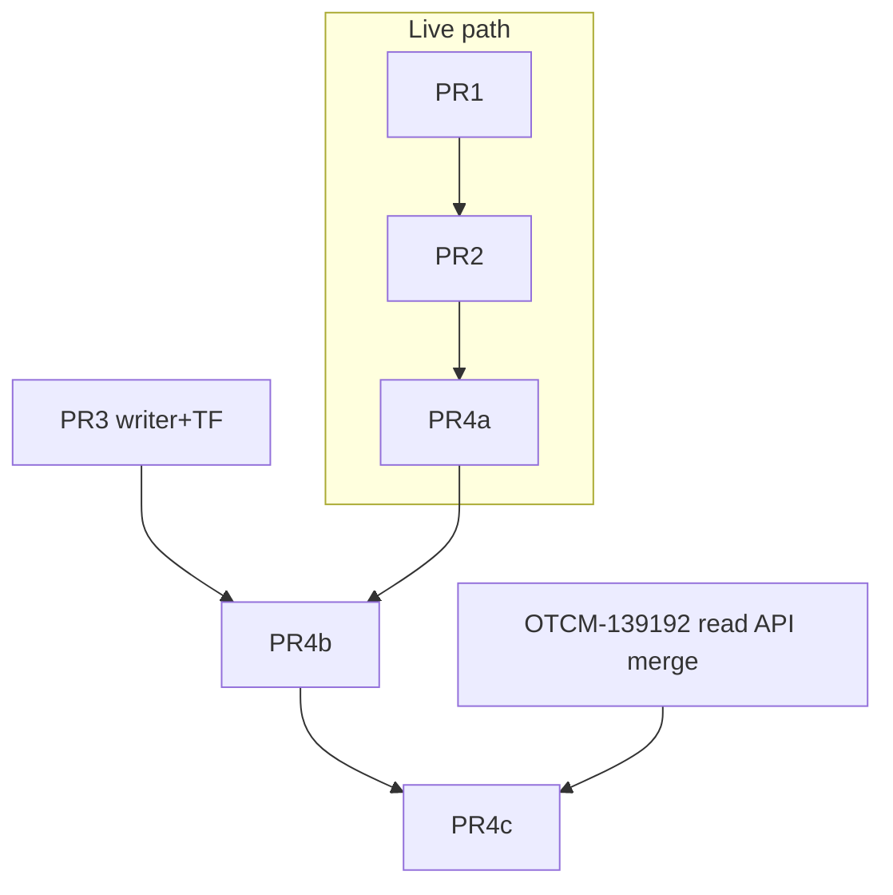

# OTCM-138123 — WMS-I-1005 idempotency + transaction_failures replay

## Overview

Implement the spike's two idempotency changes (hardened by a two-round adversarial panel) plus the replay mechanism for WMS-I-1005 `transaction_failures` rows: a `POST /transaction-failures/{failure_id}/reprocess` endpoint that claims a payload atomically, re-runs it side-effect-free, and stamps per-order outcomes.

Design was verified by 3 independent seats (round 1) and 2 adversarial seats (round 2, both ADOPT WITH CHANGES); all foldable claims were re-verified against the code by hand.

**Ticket**: [OTCM-138123](https://warbyparker.atlassian.net/browse/OTCM-138123) — "Evaluate how to make WMS-I-1005 idempotent to safely support reprocess from `transaction_failures` without duplicating downstream effects (Oracle/LMS side effects on retry)."

**Working ACs** (ratified with owner):
- AC1 — Retry of an already-succeeded attempt produces ZERO new side effects (no double pick confirm, no duplicate fulfillment event, no duplicate LMS/DST file, no retry-caused short-pick cancellation).
- AC2 — Every WMS-I-1005 `transaction_failures` row has a defined replay outcome: succeeds, refused with reason, or unnecessary.
- AC3 — Replay is operator-triggered, respects FAILED → RETRYING → RESOLVED/FAILED/DEAD, and is safe against concurrent replays of the same payload.
- AC4 — No regression on the live first-attempt path (100% unit-coverage gate).

## Verified facts the plan builds on

- Orchestrator [`_wms_pick_confirmation.py`](monocle_integrations/_domain/_integrations/_wp_wms_i_1005_wms_to_oracle_pick_confirmation/_wms_pick_confirmation.py): map/validate → **DST step (LMS side effect) runs BEFORE Oracle** → roosevelt/legacy processing → archive payload to S3 `Archive/` or `Error/` → `_record_failures` stamps payload pointer (bucket/key/version_id) and writes buffered rows. `tracking_id = uuid4()` per run.
- [`_erp_pick_confirm_processor.py`](monocle_integrations/_domain/_integrations/_wp_wms_i_1005_wms_to_oracle_pick_confirmation/_processors/_erp_pick_confirm_processor.py): `_validate_and_filter_eligible_shipment_lines` (~L996) raises `PickConfirmNotAllowedError` when ALL lines **of the whole order** are in `_NOT_ELIGIBLE_STATUSES = {Canceled, Interfaced, Staged}`; quantity map fed `eligible_lines_to_confirm + eligible_lines_to_release` only (L226-229); multi-slip branch posts full `slip.requested` per line ignoring picked total (~L712-719); single-slip branch posts item picked total onto possibly smaller slip (~L720-723); **second call site** at L290 (roosevelt post-wave re-read, tuple-unpacks the result).
- SO publish exclusion ([`_wms_pick_confirmation.py:529`](monocle_integrations/_domain/_integrations/_wp_wms_i_1005_wms_to_oracle_pick_confirmation/_wms_pick_confirmation.py)) `_exclude_failed_erp_sales_orders` excludes only orders whose ERP result **raised** — a skip-success return would publish (duplicate fulfillment event; SNS FIFO dedupe window is 5 min only).
- `transaction_id = sha256(org-ship_set-fr_ids-event_timestamp)`, `event_timestamp` from WMS payload `picked` field → **stable across replays**.
- Writer [`_transaction_failure_dynamodb_action.py`](monocle_integrations/_adapters/_transaction_failure_actions/_transaction_failure_dynamodb_action.py): unconditional upsert, `#status = if_not_exists(#status, :failed)` (recurrence after RESOLVED stays invisible), payload pointer fields overwritten on every re-record, `retry_count` never written. No `ConditionExpression` anywhere.
- Table GSIs (localstack TF): `status`+`last_failed_at`, `rice_id`+`last_failed_at`, `order_id`+`last_failed_at`. No payload-pointer GSI. Port record [`_transaction_failure_record.py`](monocle_integrations/_domain/_ports/_transaction_failure/_transaction_failure_record.py) has all 5 statuses + `retry_count`; `idempotency_key`/`last_retry_at`/`reprocessed_*`/`ttl` do NOT exist.
- Read API (OTCM-139192, in QA as vstage449): adapters + domain ports on `main`; **routes only on branch `origin/OTCM-139192-transaction-failure-routes`** ([`_api/_routes/_transaction_failure/`](monocle_integrations/_api/_routes/)), diverged from main. AVP actions exist on main: `viewTransactionFailures` / `manageTransactionFailures` ([`_api/_authorization/_actions.py`](monocle_integrations/_api/_authorization/_actions.py)); `transaction_failures.manage` defined, unused.
- `fulfill-events-sns-topic` + `fulfill-events-source-type` = `true` in prod/stage/dev ([`_feature_flag_config/prod.yml`](monocle_integrations/_feature_flag_config/prod.yml)) — SO events publish to SNS FIFO `labs-fulfill-events-prod-use1.fifo`.
- `FileContentReader.__call__(file_path)` ([`_file_storage/_reader.py`](monocle_integrations/_domain/_ports/_file_storage/_reader.py)) — no version_id support today.
- Facade attribute: `wp_in_wms_i_1005_wms_to_oracle_pick_confirmation(request: List[WMSPickOrder])`, called by [`_scale_wms_pick_confirmation_routes.py:100`](monocle_integrations/_api/_routes/_pick_ship_confirm/_scale_wms_pick_confirmation_routes.py) under `set_rice_id(...)`.
- `PickFailedStep` ([`_constants.py`](monocle_integrations/_domain/_integrations/_wp_wms_i_1005_wms_to_oracle_pick_confirmation/_constants.py)): `resolve_erp_order_number`, `read_shipment_lines`, `create_pick_wave`, `read_pick_slip`, `create_pick_confirm`, `publish_fulfillment_pick_event`, `wms_pick_confirmation`, `archive_payload`.

## PR split

Sequential stack on `main` from a fresh branch (current checkout is on unrelated `OTCM-153073-...`). Link with `gh stack link` as PRs open. Each PR passes the full gate alone (100% unit coverage, mypy strict, line 99).

- **PR1 — `[OTCM-138123] Skip pick confirmation when request-matched lines are pick-terminal`** (~380 lines incl. tests)
  - New `PICK_TERMINAL_SHIPMENT_LINE_STATUSES` frozenset = {Staged, Shipped, Interfaced, Shipped and interfaced, Pending inventory processing} in [`_shipment_lines_reader.py`](monocle_integrations/_domain/_ports/_erp_reader/_pick_ship_confirm/_shipment_lines_reader.py) (ship-side sets untouched).
  - Rewrite `_validate_and_filter_eligible_shipment_lines` → request-matched classifier (SO by FR id `src_attribute_2`; TO by item): partition matched lines first; ≥1 matched AND all matched non-canceled terminal OR all matched canceled → skip-success instead of raise. **Both call sites** (L208 main, L290 roosevelt re-read) get skip semantics.
  - New dedicated zero-match error code (data mismatch stops masquerading as `OverpickedQuantityError`); partial match classified loudly.
  - Classify or prove-unreachable the unclassified statuses (`Not shipped`, `Not applicable`).
  - Skip-success carries the `skip_reason` log (compensates the removed Jira-ticket signal for canceled orders — conscious trade-off: that ticket class IS the OEH noise). Review resolution: keep the plain interpolated text QA greps for AC4-d, no structured field.
  - Skip representation: `ERPPickedDetail` with no lines + additive skip marker; does NOT leak into SO event payloads (events build from `PickOrder`).
  - Depends on: nothing.
  - **SHIPPED 2026-11-10 as [#2900](https://github.com/WarbyParker/monocle_integrations/pull/2900)** (+1020/−139, 14 files). Two panel rounds resolved (round 1: 16 findings; round 2 on the delta: 12 findings, all implemented — records in `tmp/otcm138123_pr1_review/triage_plan.yaml` and `tmp/otcm138123_pr1_review_r2/triage_plan.yaml`). Scope grew in review: identity-based publish exclusion + `omg_skipped` attachment + key-collision WARNING naming work units; `PickConfirmNoEligibleShipmentLinesError` for matched lines with no pick work, message keyed by (line id, item, status, FR); success-path WARNING for ignored unworkable lines; `recorded_failure` assertions on the new error tests. **MERGE GATE: stage evidence for (a) `Pending inventory processing` pick-terminal and (b) Oracle safely rejecting a double-confirm POST.**

- **PR2 — `[OTCM-138123] Count done work in pick-confirm quantities and cap by picked budget`** (~400 lines incl. tests)
  - `_map_order_line_quantities` fed all non-canceled **request-matched** lines (not eligible-only).
  - Picked-budget allocation in confirm mapping: `budget = picked − Σ requested of terminal matched lines`; per slip line in deterministic order post `min(slip.requested, remaining_budget)`; serials sliced to posted quantity; None-guard on `requested_quantity` (Optional[int]).
  - Capping driven by anything other than slip-requested raises (records a row) — no silent under/over-confirm.
  - Per-line Short Pick reason only on actual quantity mismatch (FSD §4 + Alexis Tomacruz's 2026-05-28 FSD comment); fixes the PICK_EXACT → SHORT_PICK_RESERVE flip for multi-wave remainders.
  - Empty-confirm guard: skip-success when zero **mapped** pick lines (never keyed on picked>0 — zero-pick short picks legitimately post `picked_quantity: 0`); "wave created this run → never skip" clause.
  - True overpick still refuses pre-write (`_check_over_picked_lines`, L247).
  - Depends on: PR1 (same processor file).

- **PR3 — `[OTCM-138123] Extend transaction_failures writer for the replay lifecycle`** (~330 lines + TF)
  - Record action ([`_transaction_failure_dynamodb_action.py`](monocle_integrations/_adapters/_transaction_failure_actions/_transaction_failure_dynamodb_action.py)): reopen semantics — recurrence flips RESOLVED → FAILED via `ConditionExpression` (`#status IN (:resolved, :failed) OR attribute_not_exists(#status)`); `ConditionalCheckFailedException` caught as no-op (RETRYING/DEAD/IGNORED rows never resurrected); preserve original `transaction_id` on re-record (if_not_exists).
  - New `TransactionFailureStatusUpdateAction` port + DynamoDB adapter: conditional transitions (FAILED → RETRYING claim with `retry_count` + 1, `last_retry_at`, `reprocessed_by`; RETRYING → RESOLVED/FAILED/DEAD write-back with `reprocessed_at`, `ttl`).
  - Port record + item mapper + read models: add `retry_count`, `last_retry_at`, `reprocessed_at`, `reprocessed_by`, `ttl` (read API response extension is additive, lands with PR4c on the route branch).
  - Terraform: enable TTL on the `transaction_failures` table (`infrastructure/us-east-1` + localstack mirror) — **SRE review required per CODEOWNERS**.
  - Depends on: nothing (parallel to PR1/PR2).

- **PR4a — `[OTCM-138123] Add replay context to WMS-I-1005 pick confirmation`** (~250 lines incl. tests)
  - New frozen `PickReplayContext` dataclass: `suppress_dst: bool`, `order_failed_steps: dict[str, str]` (order_id → failed_step of the row being replayed).
  - Orchestrator `__call__(request, replay: PickReplayContext | None = None)`: when `suppress_dst`, skip the DST step (per-order rows prove DST ran on attempt 1 — DST precedes all per-order steps).
  - SO publish gate: publish for an order iff (it had live ERP confirmation this run) OR (`order_failed_steps[order] == publish_fulfillment_pick_event`). Skip-success orders never publish — closes the duplicate-fulfillment-event channel the panel found.
  - Design the publish ledger the PR1 review surfaced (run-1 confirm ok + SO publish fails → reprocess skip-excludes the order and its event is lost until manual repair): a DynamoDB ledger keyed by transaction_id, batch-get before send, conditional-put after success — with the ledger, skipped orders no longer need blanket publish exclusion. Decide scope at PR4a: ledger vs. the current identity exclusion + manual-republish runbook note.
  - `replay=None` → byte-identical current behavior (AC4).
  - Depends on: PR1, PR2 (same files).

- **PR4b — `[OTCM-138123] Add ReprocessTransactionFailure use case`** (~400 lines incl. tests)
  - New use case package `_domain/_use_cases/_reprocess_transaction_failure/` (or integration-adjacent `_steps` if it fits facade conventions better — decide at implementation).
  - Flow: by-id read → refusals (row signals only: status ∉ {FAILED}; null payload pointer → "correct and re-POST from OIC"; `retry_count` at cap → DEAD (None coerced to 0); unsupported rice_id) → sibling resolution (load payload → order ids → `order_id` GSI per order → filter rice_id=WMS-I-1005) → **atomic payload claim**: one `TransactWriteItems` ConditionCheck+Update over ALL sibling rows FAILED → RETRYING (any non-FAILED row aborts → 409 already-replaying; >90 siblings refused with documented reason — DynamoDB 100-item transaction cap) → payload load via `FileContentReader` extended with optional `version_id` (fallback unversioned GET) → parse `List[WMSPickOrder]` → facade call with `PickReplayContext` (`suppress_dst=True` when all claimed rows are per-order; per-order `failed_step` map) → per-order outcome stamping (RESOLVED + `reprocessed_at` + `ttl`; failures back to FAILED — the run's own recording bumps `occurrence_count` on the same `failure_id`; DEAD past cap; never stamp rows in DEAD/IGNORED or a RETRYING held by another operator).
  - Stuck-RETRYING lease: `last_retry_at` older than the lease timeout (1h) is claimable again.
  - RETRYING-lease + claim/write-back go through PR3's `TransactionFailureStatusUpdateAction`.
  - Depends on: PR4a, PR3.

- **PR4c — `[OTCM-138123] Expose POST /transaction-failures/{failure_id}/reprocess`** (~120 lines incl. tests)
  - Route beside the read routes in [`_transaction_failure_routes.py`](monocle_integrations/_api/_routes/_transaction_failure/_transaction_failure_routes.py): thin handler, CF-JWT identity → `reprocessed_by`, AVP check.
  - [`_actions.py`](monocle_integrations/_api/_authorization/_actions.py): add `"/transaction-failures/{failure_id}/reprocess": MANAGE_TRANSACTION_FAILURES` to `ROUTE_ACTIONS`.
  - Read-API response models extended additively with the PR3 fields.
  - Depends on: PR4b AND **read-API stack (OTCM-139192) merged to main** — external dependency, in QA now. If it hasn't merged when PR4b lands, PR4c stacks on `OTCM-139192-transaction-failure-routes`.

- **Follow-up ticket draft (file only, never filed)**: `tickets/OTCM-138123/followup_to_line_level_matching.md` — TO line-level matching via movement request / `source_order_line`, covering BOTH the confirm path and the skip path (same-item TO siblings can mis-skip or mis-confirm; FSD confirms data feasibility via `OrderLineNumber` ↔ `ERPOrderLine`).

## QA test-scenarios matrix (requirement-traceable)

We run against stage; QA verifies. Evidence per `jira-qa-evidence` skill (OIC instance ids, Lambda logs, DynamoDB row snapshots, Oracle shipment-line states before/after).

- **AC1-a** Replay of a fully-succeeded payload → zero new side effects: Oracle shipment lines unchanged, no new fulfillment event on `labs-fulfill-events`, no new `.dst` on the LMS share. (unit + stage)
- **AC1-b** Replay of an ERP-confirmed, publish-failed order (`failed_step=publish_fulfillment_pick_event`) → ERP skip-success, exactly ONE fulfillment event published. (unit + stage)
- **AC1-c** Replay of a create_pick_confirm-failed order → DST suppressed, ERP confirm succeeds, exactly one publish. (unit + stage)
- **AC1-d** False-overpick class (9 OEH ticket classes): pre-D1 row replays to success post-D1. (unit per class + 1 stage case)
- **AC1-e** Partial replay (some request lines already terminal) → only remaining work confirmed; no short-pick cancellation of siblings. (unit + stage)
- **AC2-a** True overpick → refuses pre-write, row recorded, replay fails again harmlessly pre-write. (unit)
- **AC2-b** ARCHIVE_PAYLOAD / mapping-failure rows → refusal reason says "correct and re-POST from OIC". (unit)
- **AC2-c** Retry cap reached → row transitions DEAD, further replay refused. (unit + localstack)
- **AC2-d** Zero-match request → dedicated error code (not overpick). (unit)
- **AC3-a** Two concurrent replays of sibling rows → exactly one wins (TransactWriteItems abort → 409); loser gets already-replaying. (unit + localstack)
- **AC3-b** Stuck RETRYING past lease (1h) → claimable again. (unit + localstack)
- **AC3-c** Recurrence after RESOLVED → row reopens to FAILED, replayable again; recurrence during RETRYING/DEAD/IGNORED leaves status untouched. (unit + localstack)
- **AC4-a** Exact first picks byte-identical (existing unit suite + 1 stage order per order type: SO, TO, lens/frame incremental AI/SURF). (unit + stage)
- **AC4-b** Short-pick multi-slip first attempt → capped posting, per-line Short Pick reason only where mismatched; ESS auto-cancel behaves per FSD §4. (unit + stage, QA sign-off — behavior change)
- **AC4-c** Zero-pick short pick → still posts `picked_quantity: 0` + Short Pick (NOT skipped). (unit + stage)
- **AC4-d** Canceled TO pick conf → skip-success, no Jira ticket, `skip_reason` in logs. (unit + stage, QA sign-off — FSD scenario intentionally overridden). Extended by the PR1 review: the sign-off covers skip-success on ALL pick-terminal statuses (including ship-confirmed-and-not-yet-picked, which loses its overpick-path Jira signal without a ratified decision), not only the canceled case.
- **AC4-f** Validate `picked_quantity` population on live stage shipment lines. Decides whether a pick-evidence guard on the skip predicate (skip only with pick evidence; Canceled exempt) is feasible; the guard lands only if stage data supports it. (stage read-only)
- **AC4-e** Multi-wave remainder pick → no spurious Short Pick exception. (unit + stage, QA sign-off — behavior change)
- **Oracle-behavior assumptions to validate on stage before merge of PR1/PR2**: `Pending inventory processing` is pick-terminal (a pending transaction that errors later must not be swallowed); Oracle rejects/ignores a double-confirm POST safely.

## Rollout / sequencing notes

- No new feature flags: replay is operator-triggered via AVP-gated route; live-path changes are corrections, not modes. Flag drift at replay time (replay uses CURRENT flag state) is deliberate — document in PR4c description.
- Stage QA heads-up in every PR touching the live path (PR1, PR2): short-pick cancellation outcomes and Short Pick reason attachment change on live traffic.
- PR3 TF change needs SRE approval; queue the review early.
- Deploy via `make deploy-stage` tags after merges; QA matrix runs on stage before prod tag.
- Read-API merge (OTCM-139192) is the only external blocker; PR1-PR4b are independent of it.

## Questions — exact texts and response history

- **Q1** (2026-11-10): "Scope: (a) implement spike changes #1/#2, (b) only document/decide, (c) also design the replay mechanism (spike rec #5)?" → **Answer: a + c** — implement the changes AND design the replay mechanism.
- **Q2** (2026-11-10): "Terminal set: adopt the spike's wider pick-terminal set {Staged, Shipped, Interfaced, Shipped and interfaced, Pending inventory processing} even though `Pending inventory processing` is ship-side in-flight (IN-I-2017B semantics)? What is the idempotency mandate?" → **Answer: adopt the wider set; mandate = ZERO side effects on retry** (no double pick, no double confirm, no duplicate fulfillment/LMS effects, no retry-caused short-pick cancellations). `Pending inventory processing` is pick-done.
- **Q3** (2026-11-10): "Matching scope: (A) request-matched scoping applied consistently (terminal check, quantity map, eligibility) — TO by item, SO by FR id; (B) whole-order scoping?" Presented with the hazard: whole-order + naive quantity fix posts sibling slip lines with picked 0 + Short Pick → auto-cancels siblings (masked today only because false overpick errors first). → **Answer: A**.
- **Q4** (2026-11-10): "Sync the FSD before relying on it?" → **Answer: yes** — added `WMS-I-1005-docs` entry to `integrations/sync/catalog.yml`, synced via `sync.sh --refresh --no-commit --only WMS-I-1005-docs` (v1.8, 2026-07-14 + 12 open comment threads; changes unstaged in `integrations` repo, user to decide on commit).

## QA / functional back-and-forth log

- 2026-11-10 — Spike reviewed: [WMS-I-1005 Pick Confirm Auto-retry and idempotency](https://warbyparker.atlassian.net/wiki/spaces/OT/pages/10536812552) (Johnny Coral, v13, 2026-10-05). Recs #3/#6 verified DONE in code; changes #1/#2 verified NOT implemented; rec #5 = this ticket's replay design.
- 2026-11-10 — FSD synced (v1.8, 2026-07-14, predates roosevelt): §4 short-pick auto-cancel (ESS job), §5.2 `transaction_id` dedupe intent, §5.3 incremental picks (AI/SURF partial payloads are normal traffic). 12 open comment threads reviewed — none blocking.
- 2026-11-10 — FSD tension recorded: test scenario "pick conf on canceled TO → fail + Jira ticket" conflicts with all-canceled → skip-success. Decision: skip-success wins (the Jira class is the OEH noise); compensated with structured `skip_reason` logging. QA sign-off row AC4-d.
- 2026-11-10 — Alexis Tomacruz's 2026-05-28 FSD comment: Short Pick reason belongs only on quantity mismatch → drives PR2's per-line reason rule. QA sign-off row AC4-e.
- 2026-11-10 — Adversarial panel (5 seats total, 2 rounds): 5 blockers folded (SO-publish duplicates on skip, D1.8 mapping rows dropped, overpick hard-refuse dropped, payload-scoped mutex via TransactWriteItems, picked-budget formula corrected); 12 concerns folded; reports consolidated and scratch removed.
- OPEN for stage validation (QA, not blocking implementation): `Pending inventory processing` pick-terminal assumption; Oracle double-confirm POST behavior; `picked_quantity` population (AC4-f).
- OPEN items from the PR1 review (2026-11-10):
  - FSD §9/§10 addendum request — the shipped skip-success behavior contradicts the FSD test scenarios of record until the addendum lands (requested after PR1 merge; rides the QA task).
  - Functional question: does Manhattan ever redeliver a pick confirmation with altered quantities? The skip trusts status only; if altered-quantity redelivery is real, the accounting design belongs to PR2's quantity work.
  - Functional/OIC-owner confirmation: no parallel pick-confirm writer exists for OMG-sourced SOs (legacy OIC flow, manual Oracle confirm). A "yes, a parallel writer exists" answer upgrades PR4a's publish ledger from option to mandatory.
